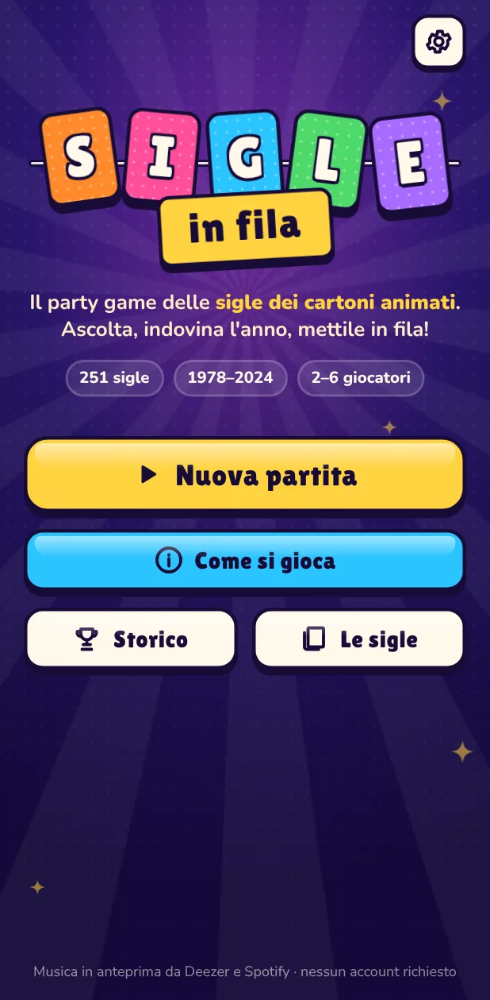
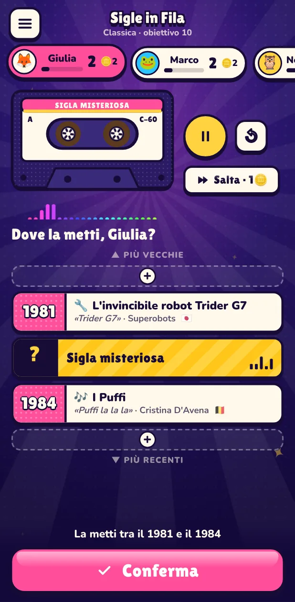
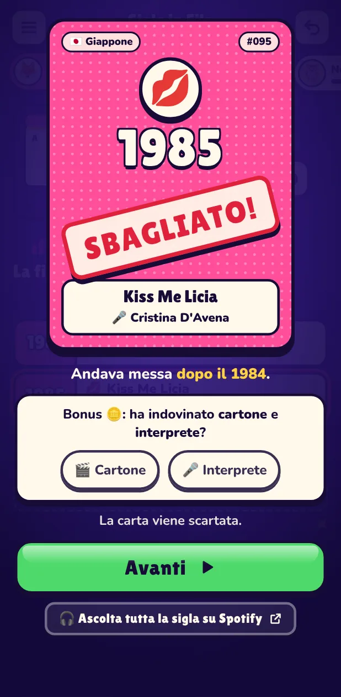
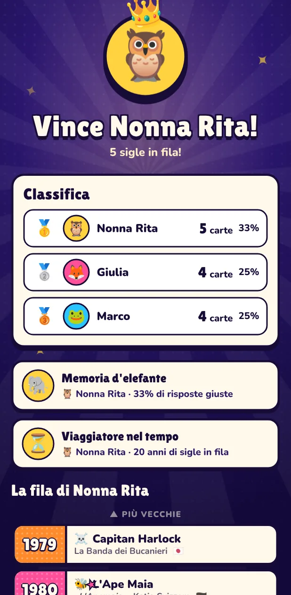

# Sigle in Fila 🎵📼

**A Hitster-style party game made of Italian cartoon theme songs** ("sigle dei cartoni animati"),
from *Ufo Robot* (1978) to the latest Cristina D'Avena and Giorgio Vanni themes.
One phone, 2–6 players, no accounts: a song plays with its title hidden, you guess when it first
aired in Italy and slot the card into your own timeline. First to 10 cards wins.

<p align="center">
  
  
  
  
</p>

## Play

| | |
|---|---|
| 📱 **Android** | Download [`SigleInFila.apk`](https://github.com/FlamingFury00/Cartoon-Hitster/releases/latest/download/SigleInFila.apk) on the phone and open it (allow installs from the browser the first time). New versions install over the old one and keep saved games and history. |
| 🌐 **Browser** | <https://flamingfury00.github.io/Cartoon-Hitster/> — works on any phone; "Add to Home screen" installs it as an app (PWA, works offline except for the music). |

Both are published automatically by GitHub Actions on every push to `main`
(the web version needs GitHub Pages enabled once: *Settings → Pages → Source: GitHub Actions*).

## New players: the tutorial

*Impara a giocare* (on the home screen the first time, then in *Come si gioca*) is a two-minute
interactive tutorial guided by Nastrina, a talking cassette. You learn by playing a short scripted
game against Bruno: listen to real themes, place cards on your timeline (helped, then on your own),
turn them over with the drum roll, win a bonus token and challenge Bruno to steal his card. It uses
the real components, songs and sounds, and never touches the saved game.

## How a turn works

1. **Pesca la sigla** — a random song you have not heard recently starts playing. Title, cartoon
   and singer stay hidden (a cassette with a live spectrum is all you see).
2. **Place it** — tap (or drag) the mystery card into a gap of your timeline: before, after or
   between the cards you already own.
3. **Challenge** (tokens on) — other players can spend a token to bet on a different gap.
4. **Gira la carta!** — drum roll, flip: year, cartoon, song and singer. Right place → you keep
   the card. Wrong → it is discarded, or stolen by the first challenger who was right.
5. **Bonus** — name both the cartoon and the singer to earn a token
   (tokens: skip a song for 1, challenge for 1, buy a card for 3).

Modes: **Classica**, **Esperto** (you keep the card only if you also name the cartoon) and
**Squadra** (co-op: one shared timeline, tokens are lives). Options: target 5–15 cards,
equal turns, deck filters by decade, fame and genre (Cristina D'Avena, Giorgio Vanni, super
robots, magical girls, sport, anime, western cartoons). The full rules are in the app
(*Come si gioca*).

## The deck

**251 hand-verified theme songs**, each pointing to the original recording (never covers,
karaoke, duets or re-recordings). The year on a card is the **first Italian release or
broadcast of that specific sigla**: shows with several themes (sequels, reruns with a new
theme) get one card per theme, with a note on the card.
How every year and recording was checked, plus the full list with sources:
[`docs/DECK.md`](docs/DECK.md). The master sheet is [`deck/songs.csv`](deck/songs.csv)
(opens in any spreadsheet).

## How the music works without any account

- Songs play from the public **30-second previews** that Deezer and Spotify serve to everyone:
  the app asks the Deezer API (JSONP) for a fresh signed preview URL and falls back to the
  Spotify preview stored in the deck. Nothing is bundled in the app.
- Previews are downloaded and decoded with the Web Audio API, so playback starts instantly,
  loops seamlessly and the next cards are preloaded during the reveal.
- Every preview was measured offline (EBU R128 loudness, ffmpeg) and is played with its own
  gain correction, so a 1978 mono recording is as loud as a 2010 master.
- "🎧 Ascolta tutta la sigla" opens the full song in the Spotify app; a settings switch can play
  every card in Spotify instead (the title is visible there, so it is a fallback only).

## Music and sound effects

The menus play their own theme, **"Happy Happy Game Show" by Kevin MacLeod** (incompetech.com,
CC BY 4.0): organ, piano, horns, bass and drums, cut into an intro and a seamless 50-second loop
(two 24-bar choruses at 230 bpm, seam refined by cross-correlation). It fades out when a game
starts or a song plays, and can be switched off in the settings (*Musica nei menu*).

Sound effects are real recordings, not synthesised beeps: cards sliding and landing on a table, poker chips for
the tokens, a concert snare roll that loops while the card spins and ends on a cymbal crash,
a boxing bell for challenges, the classic sad trombone, a crowd going "ooooh" when a card is
stolen, and a brass fanfare with a small crowd cheering for the winner. The music dips under the
big moments, like on a game show. All of them are CC0 or public domain, except the sad
trombone (CC BY 3.0, credited in the app); full list and links in [`CREDITS.md`](CREDITS.md).
The ~330 kB of MP3s in `src/assets/sfx/` and the theme in `src/assets/music/` are rebuilt from
the original sources with `npm run sfx` and `npm run theme` (ffmpeg needed).

## Development

Requirements: Node 22+, and for the APK a JDK 17+ and the Android SDK (platform 36).

```bash
npm install
npm run dev          # http://localhost:5173
npm run check        # svelte-check (strict TypeScript)
npm test             # unit tests: rules engine, tutorial script, audio files (Vitest)
npm run test:e2e     # Playwright end-to-end tests (music services are mocked)
npm run build        # production web build in dist/
npm run apk          # Android APK in android/app/build/outputs/apk/release/
```

Stack: Svelte 5 + TypeScript + Vite, a pure and fully tested rules engine
(`src/lib/game/engine.ts`), Web Audio playback (`src/lib/audio/`), PWA via vite-plugin-pwa.
The Android app (`android/`) is a small Kotlin WebView shell that serves the built web app
from its assets through `WebViewAssetLoader`, adds haptics and keeps the screen on.

### Deck pipeline

```bash
npm run deck:match      # find Deezer / Spotify candidates for deck/songs.csv (review the report!)
npm run deck:sources    # Spotify preview URLs + store metadata -> deck/sources.json
npm run deck:loudness   # ffmpeg loudness and silence analysis -> deck/sources.json
npm run deck:build      # deck/songs.csv + deck/sources.json -> src/data/deck.json (verified rows only)
npm run deck:validate   # sanity checks (also run by CI)
node tools/deck/report.mjs   # regenerate docs/DECK.md
```

Node needs `NODE_USE_ENV_PROXY=1` behind an HTTP proxy. Spotify lookups drive the public web
player with Playwright (no developer account needed).

### Signing

APKs are signed with the side-load key committed in `android/sideload.jks`, so every build can
update the previous one. It is not a secret: anyone could sign an APK with it. To use a private
key instead, add the repository secrets `SIF_KEYSTORE_BASE64`, `SIF_KEYSTORE_PASSWORD`,
`SIF_KEY_ALIAS` and `SIF_KEY_PASSWORD` (the release workflow picks them up; switching keys
requires uninstalling the old app once).

## Notes

A private, non-commercial game for family and friends, inspired by the *Hitster* card game.
All songs belong to their rights holders; the app only plays the public previews provided
by Deezer and Spotify. Music, sound effect and font credits: [`CREDITS.md`](CREDITS.md).
